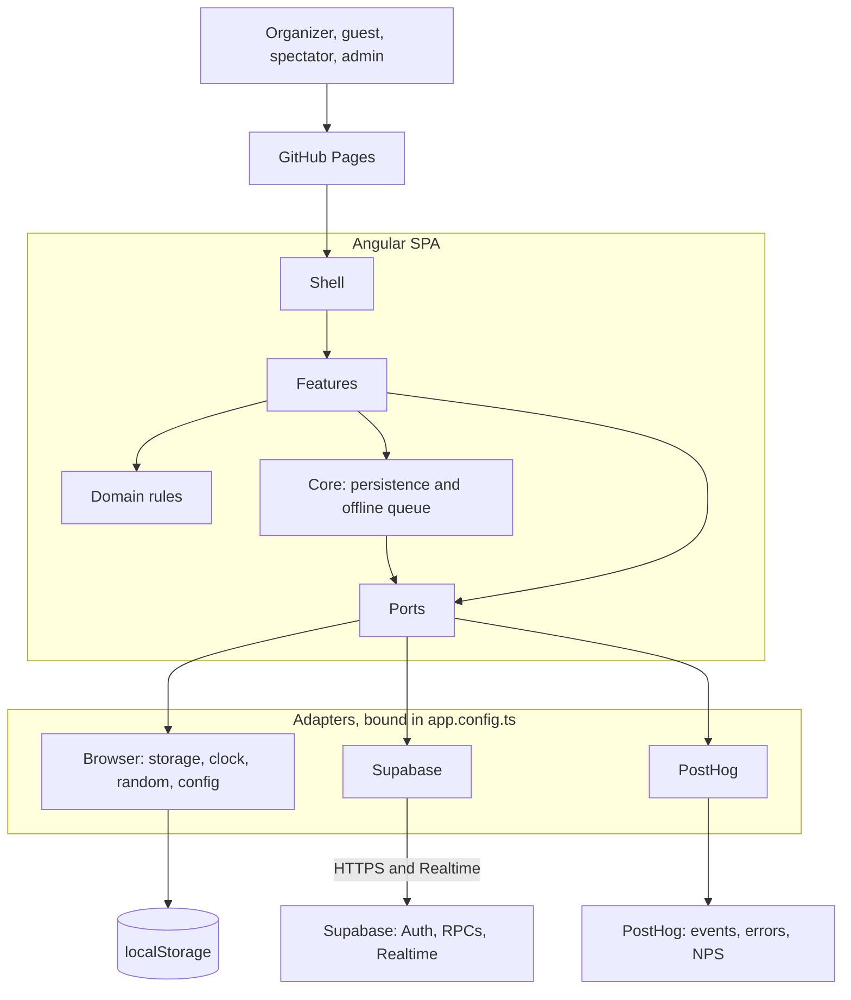

# SETPOINT

**Run a beach tennis tournament, follow every round, and share the result.**

An Angular SPA for building the draw, recording scores, following the individual standings, and running finals and the podium. It works on the device with no account. With Supabase configured, the organizer publishes a live link, invites players, and syncs scores.

[App](https://richardmvb.github.io/setpoint-beach-tennis/) · [Super Nosso Misto guide](https://richardmvb.github.io/setpoint-beach-tennis/super-nosso-misto.html) · [Contributing](CONTRIBUTING.md)

[](https://github.com/richardmvb/setpoint-beach-tennis/actions/workflows/ci.yml)
[](https://github.com/richardmvb/setpoint-beach-tennis/actions/workflows/deploy.yml)
[](https://github.com/richardmvb/setpoint-beach-tennis/deployments/github-pages)

The three badges show the latest result on `main`: the [CI](.github/workflows/ci.yml) workflow, the [Deploy](.github/workflows/deploy.yml) workflow, and the `github-pages` environment. Green is success; red is failure. What each one covers is in [Continuous integration](#continuous-integration).

The product UI is Brazilian Portuguese. This README, the code, and the commit messages are English. A name in quotes below (`Preparar`, `Ajustes`, `Meus torneios`) is the label a person sees in the app.

## Contents

- [Stack](#stack)
- [Architecture](#architecture)
- [Run locally](#run-locally)
- [Commands](#commands)
- [Continuous integration](#continuous-integration)
- [Features](#features)
- [Formats](#formats)
- [Data](#data)
- [Supabase and deploy](#supabase-and-deploy)
- [Metrics](#metrics)
- [Ranking](#ranking)
- [Privacy](#privacy)
- [Documentation](#documentation)

## Stack

| Layer       | Choice                                                                                                |
| ----------- | ----------------------------------------------------------------------------------------------------- |
| App         | Angular 22, standalone, OnPush, signals. pt-BR UI ([Transloco](docs/adr/0004-transloco-setup.md))     |
| Node        | 24 (`.nvmrc`), npm 10+                                                                                |
| Language    | TypeScript 6                                                                                          |
| Local state | Browser `localStorage`: the active tournament, the library, and the offline queue                     |
| Backend     | Supabase: Postgres, RPCs, anonymous Auth, Realtime. Migrations in `supabase/migrations/`              |
| Analytics   | PostHog (events, exceptions, NPS survey)                                                              |
| Tests       | Vitest (unit), PGlite and pgTAP (SQL), Playwright (e2e, visual, production)                           |
| Hosting     | GitHub Pages, base path `/setpoint-beach-tennis/` ([ADR 0006](docs/adr/0006-hosting-github-pages.md)) |

The version shown in the app is the number of commits reachable from the published commit. In development, without that setting, it shows `dev`.

## Architecture

The app talks to the outside world through ports in `src/app/core/ports/`. Each vendor (Supabase, PostHog, the browser) lives only in `src/app/core/adapters/<vendor>/`. Features and domain code inject ports. `src/app/app.config.ts` is the one place that binds a port to an adapter, so replacing a vendor is a new adapter folder and one line there ([ADR 0003](docs/adr/0003-ports-and-adapters.md)).



Scores are never edited in place. A feature asks `domain/` for a new tournament, then `core/` saves it. Domain functions stay free of Angular, RxJS, and vendors. Anything that arrives from an RPC is parsed with Valibot in `src/app/shared/parsers/` before it becomes app state.

| Path                      | Role                                                                                                        |
| ------------------------- | ----------------------------------------------------------------------------------------------------------- |
| `src/app/domain/`         | Pure rules: setup, standings, the bracket, the score. No Angular and no vendor                              |
| `src/app/core/`           | Application services: persistence, the offline queue, navigation, dialogs, i18n                             |
| `src/app/features/`       | Screens. The shape of an extracted feature is in [`src/app/features/README.md`](src/app/features/README.md) |
| `src/app/ui/`             | Design system (`@ui/*`): button, card, dialog on the Angular CDK                                            |
| `src/app/shared/parsers/` | Valibot parsers for outside data. No `as` cast on an RPC payload                                            |
| `supabase/`               | Forward-only migrations, pgTAP tests, and lint                                                              |
| `public/i18n/`            | pt-BR text, loaded at runtime                                                                               |

Three paths cross that boundary:

- **On the device.** The tournament, the library (`Meus torneios`, up to 30), and the offline queue sit in `localStorage` through the browser adapter. Supabase is not required to build a draw, enter scores, run finals, or restore a backup.
- **Shared and live.** The Supabase adapter publishes the shared tournament and the local live link, and subscribes to Realtime. Guests and spectators only read. Scores entered offline leave the device in order when the connection returns.
- **Product.** PostHog receives events and the NPS survey. The `/dashboard` route reads aggregate metrics through an admin-only RPC; the email session is checked against `setpoint_dashboard_admins`.

The public URL did not change when the router arrived ([ADR 0005](docs/adr/0005-public-url-scheme.md)). `NG_APP_ROUTER_ENABLED` selects the Angular Router; absent or `false`, the original URL handling stays. How to turn it on and check it: [docs/releasing.md](docs/releasing.md).

## Run locally

```bash
nvm use    # Node 24
npm ci
npm start  # http://localhost:4200
```

The wizard starts on **Preparar** and unlocks the other areas only after the draw is generated.

`public/runtime-config.js` is tracked and holds development values. Do not overwrite it. CI and the deploy generate the production file with `scripts/generate-runtime-config.cjs`.

Production build (output in `dist/setpoint/browser`):

```bash
npm run build -- --base-href /setpoint-beach-tennis/
```

## Commands

Quality, which `npm run check` runs in order:

| Command                | What it checks                                                                 |
| ---------------------- | ------------------------------------------------------------------------------ |
| `npm run lint`         | ESLint on TypeScript and templates                                             |
| `npm run lint:styles`  | Stylelint                                                                      |
| `npm run format:check` | Prettier (`src/**/*.html` is excluded: the templates are whitespace-sensitive) |
| `npm run typecheck`    | `tsc` over the app, the specs, and e2e                                         |
| `npm run knip`         | Unused files, exports, and dependencies                                        |
| `npm run i18n:check`   | Missing or unused translation keys, and raw text in a template                 |
| `npm test`             | Unit tests (Vitest)                                                            |
| `npm run test:db`      | SQL on PGlite, no Docker                                                       |
| `npm run build`        | Production build, including the bundle budgets                                 |

Database, against local Supabase (Docker):

| Command                    | What it does                                                   |
| -------------------------- | -------------------------------------------------------------- |
| `npm run db:start`         | Starts the stack and applies every migration from empty        |
| `npm run db:reset`         | Reapplies the migrations                                       |
| `npm run db:lint`          | Splinter and `supabase db lint`                                |
| `npm run db:migrations`    | Forward-only, vendor-neutral migration rules                   |
| `npm run db:types`         | Regenerates `database.types.ts` (never edit that file by hand) |
| `npm run test:db:supabase` | pgTAP permission and invariant tests on the local stack        |

End-to-end tests and performance:

| Command                                 | What it does                                                                    |
| --------------------------------------- | ------------------------------------------------------------------------------- |
| `npm run test:coverage`                 | Unit tests with V8 coverage. The floors live in `angular.json` and only move up |
| `npm run e2e`                           | Playwright against the dev server. Nothing outside localhost is reachable       |
| `npm run e2e:prod`                      | Production build, then the smoke in `e2e/production.spec.ts`                    |
| `npm run e2e:visual`                    | Pixel baselines, in the Docker image CI uses                                    |
| `npm run perf:page -- --page dashboard` | Lighthouse for one page: bytes, CLS, and LCP fail the run                       |

## Continuous integration

[`.github/workflows/ci.yml`](.github/workflows/ci.yml) runs on a pull request, nightly on `main` (each e2e test three times; a test that passes only on its retry fails the night), and when deploy calls it. A pull request that only touches documentation or SQL does not run e2e, visual, or Lighthouse. The `CI passed` job treats that skip as success, and it is the branch-protection check.

| Job              | It fails when                                                                                                                                                                    |
| ---------------- | -------------------------------------------------------------------------------------------------------------------------------------------------------------------------------- |
| `quality`        | Lint, styles, formatting, types, unused code, i18n, unit tests with coverage, PGlite SQL, `npm audit` (high), or the build breaks a bundle budget                                |
| `lighthouse`     | Bytes, CLS, or LCP on the landing page, the live view, or the dashboard cross the limit. On a pull request, TBT clearly worse than the base branch on the same runner also fails |
| `database`       | A new migration breaks the rules, Squawk, the security lint, or pgTAP, or `database.types.ts` is out of date                                                                     |
| `e2e`            | Playwright, in three shards. A test also fails on an Angular dev-mode warning (NG0100, NG0955, NG0956)                                                                           |
| `e2e-production` | The production-build smoke, under the Pages base path                                                                                                                            |
| `visual`         | A pixel differs from the baseline, inside the Playwright image the baselines were generated in                                                                                   |
| `CI passed`      | Any job above failed, was cancelled, or errored. A job skipped by the path filter counts as passed                                                                               |

[`.github/workflows/deploy.yml`](.github/workflows/deploy.yml) runs CI and, when it passes, publishes `main`. The production build requires `SUPABASE_URL` and `SUPABASE_PUBLISHABLE_KEY`; without them deploy stops. Release and rollback steps: [docs/releasing.md](docs/releasing.md).

A pull request title must be a Conventional Commit (CI checks it, because the merge is a squash). Local commits go through commitlint on the `commit-msg` hook.

## Features

- **Super:** 8, 10, 12, or 24 athletes, with rotating partners.
- **Groups:** 8, 12, or 24 athletes, with rotating partners or fixed pairs. With 20 athletes (open rotating), the format is **Grupos 20**: 5 groups of 4 or 4 groups of 5. The top 2 from each group and the best third places go through (12 athletes). They become 6 pairs (crossed, or drawn with seeds) in a bracket with byes: the top two wait in the semifinals.
- **Open or mixed pairs:** in mixed mode, each pair has one man and one woman.
- **A new draw every time:** registration order decides nothing. Pairs, groups, round order, and courts are drawn on every generation. Courts rotate so nobody stays on the same one, byes are spaced (no rest in consecutive rounds), and each format's rules still hold.
- **Profile:** the organizer's name, photo, and category, stored only on the device. On the first visit, after leaving the landing page, the profile opens once (it can be skipped with "Agora não"; later it sits on the header button). The profile fills the name fields on invites and, when the option is on, adds you as a player in new local tournaments.
- **Range controls:** players, courts, and games use range controls that follow the chosen format.
- **Batch entry:** paste a list of athletes and review names and categories before confirming. One-by-one entry stays available.
- **Scores by round:** move between rounds, larger numeric fields, and the ranking updates on its own.
- **Standings and finals:** individual criteria, tie-breaks, the final, the third-place match, and the podium.
- **Point-by-point final:** optional in any format, with a deciding point at 40–40, a tie-break at 6–6, and undo for the last point. The third-place match stays on a manual score.
- **Mixed Super 24 on 3 courts:** 12 men and 12 women in balanced waves, a ranking per category, and an optional early cut to the finals.
- **Your path (projection):** in a shared Super tournament, each athlete sees the real chance of winning, of reaching the top 2, or of reaching the top 3, computed over every possible outcome of the remaining matches (partners and opponents coupled, as in the real draw).
  - It shows the chance per goal, where the athlete can finish, how the chance moved round by round, and what each win is worth.
  - It highlights the matches that move the chance the most (theirs and everyone else's) and the rivals to watch, with the gain in percentage points.
  - **What if:** tap a match to assume the result and watch the chance recompute.
  - It says "guaranteed" or "out" only when that is mathematically certain. Up to 18 open matches the calculation is exact; above that it is a reproducible simulation.
  - It tells the athlete when a result moves their chance by 5 points or more (with confetti when the goal becomes certain) and builds an image to share.
  - Assumptions shown on screen: remaining matches are even (50/50), and ties on wins are broken by game difference and then by head-to-head. Available only in shared Super tournaments.
- **Shared invites:** guests join from the link. The moderator can add a participant who has no phone.
- **Optional photos:** WebP avatars are reduced on the device to at most 8 kB, with initials as the fallback.
- **Instagram card:** a preview before export, three layouts, and an optional background photo processed in the browser.
- **Final report:** in Ajustes after finishing, generate a PNG, share or copy the text, and create a read-only results link.
- **NPS:** a PostHog survey, in the footer and at moments when the tournament is completed.
- **Product dashboard** (`/dashboard`, administrators only), in three tabs:
  - **Summary:** indicators for the period (7, 30, or 90 days) against the previous period, with sparklines; plain-language insights ("Usage grew 35%", "Biggest drop-off: before the first score", "Peak use: Saturdays at 7pm"); a daily trend and a funnel from the start to the podium.
  - **Use and features:** format mix, completion by format, a heatmap of when tournaments start, feature adoption (live, Your path, point-by-point final, early finals, mixed and fixed pairs), moderator retention, and the shared-tournament signup funnel.
  - **Tournaments:** in progress and archived lists, where tournaments stopped, and the raw counters.
  - What the database and PostHog measure is in [`docs/analytics.md`](docs/analytics.md), with the event catalog and funnel suggestions.
- **My tournaments:** every tournament that was started is saved on the device (up to 30). Reopen any of them to review the draw, scores, ranking, and podium, including after starting another one or after a new version of the app.
- **Full cloud copy:** with Supabase configured, each local tournament that was started is archived with every detail (participants, rounds, scores, and finals) so an administrator can recover it and reopen it on the dashboard.
- **Guided setup:** a three-step wizard with options on cards, a live summary of the format, a places bar, clickable steps, and an interactive tour (driver.js) for each step.
- **Confirmations:** the app's own dialogs (Angular CDK), as a bottom sheet on a phone. Finishing the tournament requires typing `finalizar`.
- **Landing page:** the product, the formats, live following, a section for "Your path" (with the note that it applies to shared tournaments), and a shortcut back to saved tournaments.
- **Light and dark mode**, JSON backups, and the version in the header and the footer.

## Formats

| Format                |      Rounds |                 Courts | Notes                                                                                  |
| --------------------- | ----------: | ---------------------: | -------------------------------------------------------------------------------------- |
| Super 8               |           7 |                      2 | Everyone plays everyone else; partners do not repeat in the open format.               |
| Super 10              |          10 |                      2 | Byes are spread so matches stay balanced.                                              |
| Super 12              |          11 |                      3 | Everyone plays 8 matches.                                                              |
| Super 12              |          12 |                      2 | A round that equalizes matches played and byes.                                        |
| Open Super 24         |          23 |                      6 | Everyone plays in every round.                                                         |
| Mixed Super 24        |          12 |                      6 | Each athlete plays 12 matches, one with each partner from the other category.          |
| Mixed Super 24        |          24 |                      3 | Each pair of rounds equalizes matches played, which allows an early cut to the finals. |
| Open rotating groups  |           3 |            1 per group | Groups of four; each athlete partners with the other three.                            |
| Open rotating groups  |           3 |            1 per group | Grupos 20, 5 groups of 4: 5 courts, 3 rounds.                                          |
| Open rotating groups  |           5 |            1 per group | Grupos 20, 4 groups of 5: 4 courts, 5 rounds (one athlete rests per group and round).  |
| Mixed rotating groups |           2 |            1 per group | Groups of four, balanced with two athletes from each category.                         |
| Fixed groups          | Round robin | As the format requires | Pairs are set before the start.                                                        |

In every format, each generated draw shuffles the athletes (including who sits in a rotating group), shuffles the round order, and spreads the courts so each athlete passes through the different courts. In mixed Super 24 on 3 courts, the two halves of each complete round stay together, which keeps the points where everyone has played the same number of matches (required for the early finals). In groups, there is still one court per group, but a group is not stuck on the same court.

In mixed Super 24, new draws guarantee 12 matches per athlete, with no repeated partner and no repeated group of four. The generator tries to vary the matchups, and it does not guarantee that every athlete meets every other athlete. A draw that was already generated stays as it is.

The final is a single set. In point-by-point mode, spectators follow games and points on the shared link or the live link; a change made offline appears after sync.

In an early final, the final report and the final view on the link include only matches that have a score. The image can be downloaded or shared; the text can be sent through the share sheet or copied to WhatsApp. The final link is a snapshot with no live updates: an existing local link is reused when it already holds the final result; otherwise a new snapshot is published. Creating the link needs a connection and Supabase configured.

### Early finals in mixed Super 24

With **Super 24**, **mixed pairs**, **3 courts**, and early finals turned on, the moderator can generate the final stage once everyone has the same number of recorded matches. The ranking then shows a men's table and a women's table. The choice is:

- **Full bracket:** the best eight men and the best eight women form eight fixed pairs for quarterfinals, semifinals, the final, and the third-place match.
- **Direct final:** the best four of each category form four pairs for the final and the third-place match.

## Data

### On the device

The whole tournament lives in `localStorage`. Every tournament that was started also enters **Meus torneios** (header, setup, and Ajustes): up to 30, including after starting another one or after a new version of the app. Finished tournaments open read-only. Photos are not kept in the history.

With Supabase configured, Ajustes can also publish a public follow link for a local tournament, including one still in progress. That link only shows participants, matches, and scores. It does not allow joining or editing, and it does not publish photos.

When anonymous sign-in is enabled, the app sends aggregate metrics for local tournaments (no names, photos, or scores) and a full copy of each tournament that was started — participants, rounds, scores, and finals, without photos — for the dashboard. Without a connection or authentication, local use continues: the send stays pending and retries on reconnect, on opening the app, and on every change.

### Shared

Supabase stores the state and syncs participants, rounds, and results between the moderator and the guests. The moderator signs in with no email, through anonymous authentication. Guests use the invite and do not create an account. The moderator takes a place, starts the tournament, and records the scores. An incomplete invite expires in 15 minutes. A job checks every five minutes and archives shared tournaments and local live links that have gone at least 24 hours without an update on the server. On an active shared tournament, each update renews that window.

Once a shared tournament has been started and loaded on the moderator's device, scores can be recorded with no connection. The changes stay in the browser and are sent in order on reconnect. Ajustes can pause automatic sync or send now; the header status shows which. The same applies to updating the live link of a local tournament. Spectators see a new score only after sync.

Opening the app for the first time, creating or starting a shared tournament, and enrolling a guest all need a connection. Reloading the page with no network depends on the browser cache; full offline access is not guaranteed. Moderate each tournament from a single tab on a single device. The worker cannot see a change that has not reached the server yet: after 24 hours with no update there, it can archive the tournament even while offline scores sit on the device. If the server was changed from another device, or the tournament expired or was archived, sync is blocked so the local data is kept. There is no automatic merge. Export a backup before restarting or replacing the tournament. Do not clear the browser data while a change is still pending.

## Supabase and deploy

### Database

Apply the pending migrations, in filename order. With the CLI, which is the preferred path:

```bash
npx supabase link --project-ref <ref>
npx supabase db push
```

From the SQL Editor, apply each file in `supabase/migrations/` in filename order. Publish the app only after that: a live send stays pending if the RPC is not there yet.

1. In **Authentication → URL Configuration**, set the Site URL and allow the redirects you use, including `https://richardmvb.github.io/setpoint-beach-tennis/dashboard`, `http://localhost:4200/dashboard`, and `http://localhost:4201/dashboard` if you use that local port.
2. Turn on **Allow anonymous sign-ins** for the moderator without an email, for local metrics, and for publishing follow links.
3. The dashboard signs in with a magic link. The account must be in `public.setpoint_dashboard_admins`. The RPC checks the session and the allowlist in the database.

The dashboard reads metrics and, only for an allowed administrator, the state of shared tournaments, local tournaments published live, and full copies of local tournaments (`local_tournament_archives`, with no expiry). Shared photos are WebP thumbnails in Base64, limited by the app and validated on the server. They stay in the private state of the shared tournament, with no public bucket.

### Deploy variables

In **GitHub → Settings → Secrets and variables → Actions → Variables**:

| Variable                       | Role                                                                         |
| ------------------------------ | ---------------------------------------------------------------------------- |
| `SUPABASE_URL`                 | Project URL, without `/rest/v1/`. Required to deploy                         |
| `SUPABASE_PUBLISHABLE_KEY`     | Publishable key. Required to deploy                                          |
| `NG_APP_POSTHOG_PROJECT_TOKEN` | PostHog project token                                                        |
| `NG_APP_POSTHOG_HOST`          | PostHog host for the project's region                                        |
| `NG_APP_LOCK_SCREEN_ENABLED`   | Optional. `true` turns the unlock screen on; absent or `false` leaves it off |
| `NG_APP_ROUTER_ENABLED`        | Optional. `true` hands the address to the Angular Router                     |

The workflow writes `runtime-config.js`, builds, and publishes. The Pages fallback (`404.html` copied from `index.html`) lets `/dashboard` load directly. Only publishable keys belong in the frontend. `service_role` does not go in the code or in the build variables.

## Metrics

PostHog records tournament creation and start, wizard steps, navigation, scores, finals, shares, and completion. The `doubles_format` field distinguishes open and mixed tournaments. Individual categories and photos are not sent to PostHog. The catalog and the funnels: [`docs/analytics.md`](docs/analytics.md).

The dashboard aggregates local and shared tournaments (RPC `get_dashboard_insights`). Without migration `202611090002`, the new tabs warn and the rest keeps working. `setpoint_dashboard_admins` controls who can query. The in-progress list includes shared tournaments and local ones with a live link. The date is the last update the server received, and it does not mean the organizer is still connected. A local tournament with no live link has no state on the server.

Archived shared tournaments and local live links can be opened in a new tab and exported as JSON, then imported as a local tournament. The file does not revive the original tournament or invite. Archiving for inactivity closes the record without inventing a score, a podium, or a sporting result. The drop-off breakdown groups archived shared tournaments that were not finished by the stage they reached, and counts restarted local tournaments as an unknown stage. A local tournament that was never published is not archived by the job. Closing the page without restarting or archiving is not detected as a drop-off.

## Ranking

The ranking uses sets won, game difference, and games for. A tie can require head-to-head or a draw before the finals are generated. A bye neither gives nor takes points.

The generator combines validation with a heuristic search and randomness to spread matchups and byes. After the rounds are built, it only reorders the rounds and swaps the courts. The matches inside a round do not change, and the finished draw is validated again in full. It checks the format's invariants, and it does not promise a global mathematical optimum (court balance and bye spacing are the best found, not perfect). Review the generated draw before play starts.

## Privacy

- The profile (name, photo, category) stays in the device's `localStorage` and is never sent on its own. It leaves the device only when you join a tournament as a player, and then it follows the same rules as the other participants in that tournament.
- What is collected: typed names, categories (in mixed pairs), matches, and scores. Phone numbers, documents, and other personal data of the athletes are not collected. Email is used only by an administrator signing in to the dashboard.
- Local tournaments stay on the device and in **Meus torneios**. Starting another tournament removes the active state and the sync caches, and keeps the history (delete it from Meus torneios itself). The copy sent to the cloud does not include photos.
- Shared tournaments and cancelled or expired participants are archived so metrics and history are kept.
- Invite tokens are stored as a hash in the database.
- Supabase RPCs and policies are the access authority. Do not use `service_role` in the browser.
- Photos are optional, compressed on the device, and sent only in shared mode, for the tournament avatars.

Do not open a public issue for a security finding. Contact the maintainer. CSP, limits, and findings are in [`docs/security.md`](docs/security.md).

## Documentation

| Document                                                             | What it covers                                     |
| -------------------------------------------------------------------- | -------------------------------------------------- |
| [CONTRIBUTING.md](CONTRIBUTING.md)                                   | How to contribute, the hooks, and what CI requires |
| [CLAUDE.md](CLAUDE.md)                                               | Map of the code for developers and for agents      |
| [docs/releasing.md](docs/releasing.md)                               | Publishing, rollback, and the router flag          |
| [docs/security.md](docs/security.md)                                 | CSP, keys, abuse limits                            |
| [docs/analytics.md](docs/analytics.md)                               | Events, funnels, and what the dashboard measures   |
| [docs/vendors.md](docs/vendors.md)                                   | Vendors and the cost of swapping each one          |
| [docs/state-machines.md](docs/state-machines.md)                     | The app's state machines                           |
| [docs/adr/](docs/adr/)                                               | Architecture decisions                             |
| [docs/professionalization-plan.md](docs/professionalization-plan.md) | The engineering plan and its phases                |
